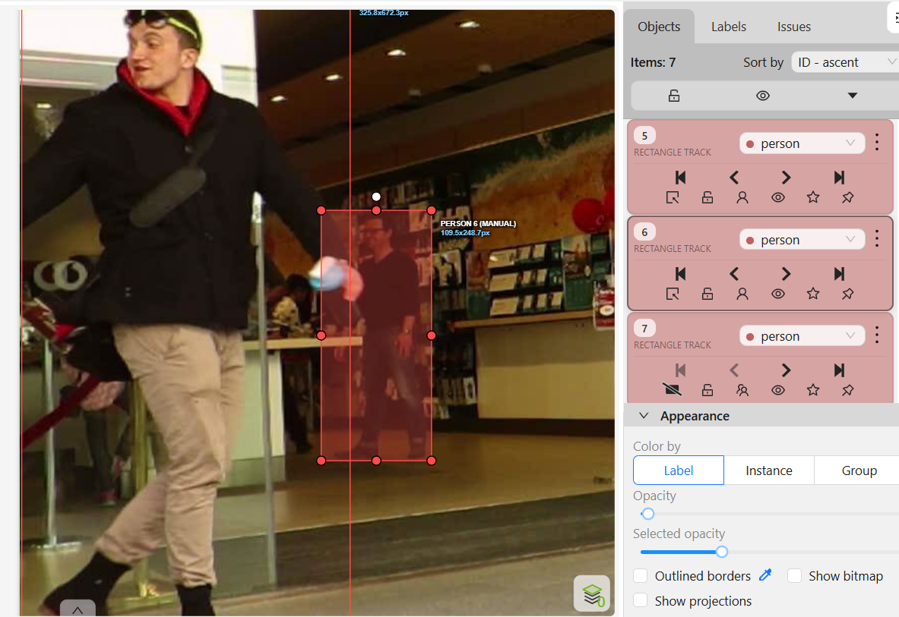
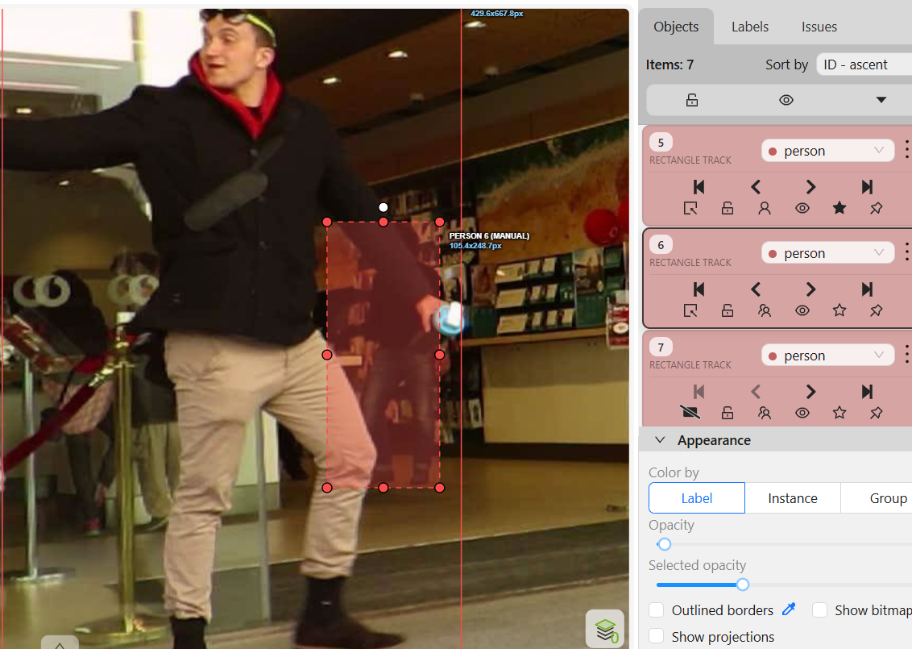
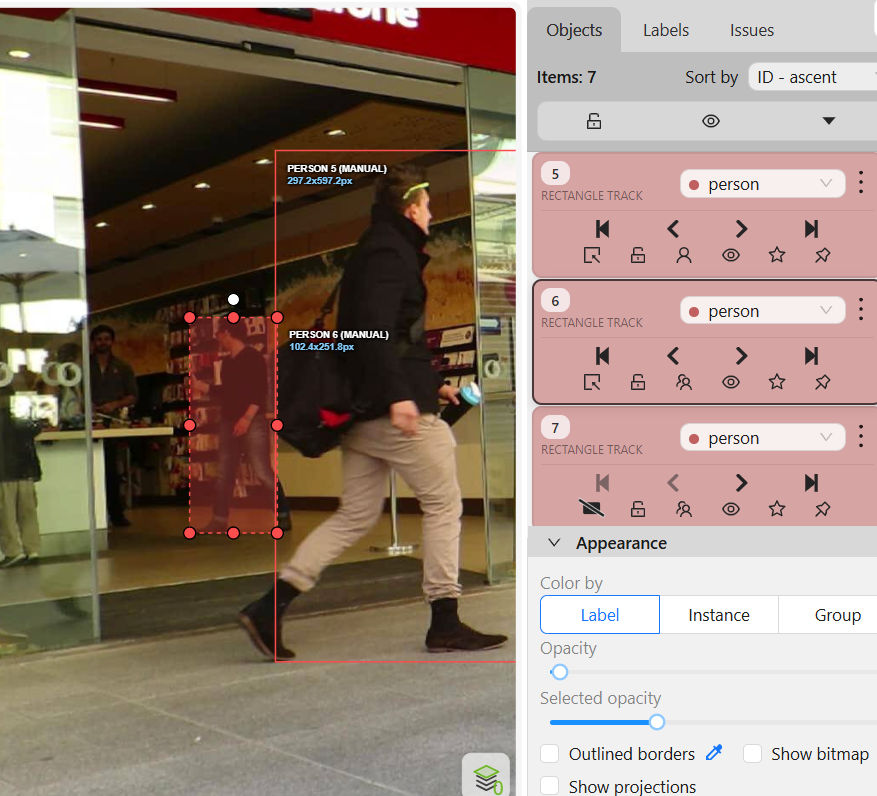

# Báo cáo cá nhân — HoVaTen-MSSV

Đổi tên file theo quy tắc `MSSV_HoTen.md`. Ví dụ: `20241234_NguyenVanAn.md`.

Đoạn video: MOT17-09, 150 frame (frame 1–150), nguồn MOTChallenge, giấy phép CC BY-NC-SA 3.0.

## 0. Thông tin học viên

- Họ tên: Phạm Duy Thanh
- MSSV: 2A202603343
- Mã đề (A/B/C): A
- Email: 26ai.thanhpd3@vinuni.edu.vn
- Link repository: https://github.com/PDTnhah/K5-L2B-DAY05-PhamDuyThanh-2A202603343-MOTTracking
- Giờ bắt đầu: 16h30
- Giờ kết thúc: 19h30

## 1. Xem trước đoạn video (CP0)

Ghi **trước khi vẽ**, mỗi người một dòng.

| Mã | Frame xuất hiện | Frame cuối thấy được | Rẽ / dừng / đổi tốc độ ở frame | Bị che ở frame | Ghi chú |
|---|---|---|---|---|---|
| P1 | 0 | 149 | Đi chéo sang trái, lại gần camera; tăng tốc rõ từ 100 | Không bị che | |
| P2 | 0 | 149 | Đi sang trái, theo sau P1, tăng tốc từ 90 | 0–63 | |
| P3 | 0 | 105 | Đi sang phải chậm, dừng hẳn từ 41 | 89–105 một phần | Từ 106 bị P1 che hết và không hiện lại |
| P4 | 0 | 146 | Đi sang phải chậm, đứng yên từ 40 | 106–109 một phần, khuất hẳn 110–135, 136–139 và 143–146 một phần | |
| P5 | 0 | 149 | Vào từ mép trái, đi sang phải, xa dần camera, tăng tốc mạnh 30–50, sau đó chậm dần | 111–118 một phần, khuất hẳn 119–127, 128–135 một phần, khuất hẳn 136–148, 149 một phần | |
| P6 | 0 | 149 | Đi sang phải chậm, chậm lại 100, quay sang trái 110–130, gần như đứng yên 130–149 | 26–39 một phần, khuất hẳn 40–49, 50–59 một phần | |
| P7 | 60 | 149 | Đi sang phải, chậm dần từ 90, gần như đứng yên 110–130, nhích sang trái từ 130 | 60–79 một phần | Phần thân dưới bị che lúc mới xuất hiện; vẽ box toàn thân ngay từ 60 và bật `occluded` |

## 2. Keyframe và thời gian (CP1, CP4)

Số keyframe lấy từ kết quả `src/check_submission.py`.

| Mã | Số keyframe | Keyframe ở frame | Số frame có mặt | Keyframe / 100 frame | Thời gian (phút) | Chỗ khó |
|---|---|---|---|---|---|---|
| P1 | 26 | 0, 6, 10, 11, 13, 20, 30, 40, 50, 60, 70, 76, 80, 90, 100, 110, 120, 121, 122, 123, 124, 125, 130, 140, 144, 149 | 150 | 17.3 | 5 | Đi chéo lại gần camera nên box to dần, phải tự đặt lại nhiều box |
| P2 | 23 | 0, 1, 3, 6, 8, 10, 11, 15, 20, 30, 40, 50, 60, 64, 70, 80, 90, 100, 110, 120, 130, 140, 149 | 150 | 15.3 | 5 | Ban đầu bị che khuất nên khó đoán box cao đến đâu, rộng đến đâu, những box bị khuất ban đầu phải check từng frame liên tục |
| P3 | 7 | 0, 1, 11, 21, 31, 41, 89 | 106 | 6.6 | 5 | do không di chuyển mấy từ frame 41 nên không cần đặt lại nhiều, không có chỗ khó mấy, chỉ cần check thêm nơi bắt đầu bị che |
| P4 | 10 | 0, 10, 20, 30, 40, 106, 136, 138, 140, 143 | 121 | 8.3 | 5 | Sau khi bị khuất, check kĩ các frame sau để xem frame nào xuất hiện lại, và frame nào lại bị che 1 lần nữa |
| P5 | 25 | 0, 3, 6, 10, 20, 30, 31, 32, 33, 34, 35, 36, 40, 43, 50, 60, 70, 80, 90, 100, 110, 111, 128, 130, 149 | 128 | 19.5 | 5 | Ban đầu chuyển động tay nhiều nên phải chỉnh box nhiều, sau đó chuyển động nhanh phải chỉnh box theo, cuối cùng phải check bắt đầu khuất từ frame nào |
| P6 | 16 | 0, 10, 20, 26, 30, 50, 60, 70, 80, 90, 100, 110, 120, 130, 140, 149 | 140 | 11.4 | 5 | Bị che một phần từ frame 26, khuất hẳn 40–49, cần check frame nào bắt đầu hiện lại (50) và frame nào thấy rõ trở lại (60) |
| P7 | 10 | 60, 70, 80, 90, 100, 110, 120, 130, 140, 149 | 90 | 11.1 | 5 | Xuất hiện từ frame 60 với phần thân dưới bị che nên phải ước lượng box toàn thân và bật `occluded` (60–79); sau đó đi đều nên chỉ cần keyframe mỗi 10 frame |
| **Tổng** | **117** | | **885** | **13.2** | | |

Keyframe / 100 frame của cả bài = tổng keyframe ÷ tổng số frame có mặt × 100 = 117 ÷ 885 × 100 ≈ **13.2**.

Bạn đặt keyframe nhiều nhất ở người nào? Vì sao (người đó rẽ, dừng, lại gần camera hay bị che)?

   - Nhiều nhất ở người P1, do không bị khuất, di chuyển liên tục, chuyển động tay ra xa thân, có xu hướng lại gần nên box cần to lên liên tục

## 3. Đoạn bị che (CP2)

Người bị che: `P4`

| Mốc | Frame |
|---|---:|
| Bắt đầu bị che một phần (bật `occluded`) | 106 |
| Mất hẳn (bật `outside`) | 110 |
| Hiện lại (tắt `outside`) | 136 |
| Thấy rõ trở lại (tắt `occluded`) | 140 |

- Thời gian khuất hẳn: 26 frame = 0,87 giây.
- Quyết định: giữ cùng ID.
- Lý do (trả lời 3 câu: khuất bao lâu so với 60 frame, ngoại hình có khớp, chỗ hiện lại có đúng hướng và tốc độ)::
  - Chỉ khuất 26/60 frame (tính từ ban đầu đến khi hiện lại lần đầu tiên)
  - Chỗ hiện lại đúng với vị trí trước đó (trước đó đang đứng yên)


Ảnh chụp màn hình:





## 4. Tự review ID (CP3)

| Frame | Mã người | Loại lỗi | Mô tả một câu | Phát hiện ở lượt | Đã sửa? |
|---:|---|---|---|---|---|
| 60 | P7 | flag | người bị che khuất thân dưới nhưng chỉ vẽ box phần thân trên và thiếu cờ occluded | 1 | Đã sửa |


Tổng hợp số lỗi theo loại:

| `id_switch` | `fragmentation` | `lost` | `merge` | `false_track` | `drift` | `flag` |
|---:|---:|---:|---:|---:|---:|---:|
| 0 | 0 | 0 | 0 | 0 | 0 | 1 |


## 5. File xuất và kết quả tự kiểm (CP4)

| Kiểm tra | Kết quả |
|---|---|
| Tên file MOT 1.1 | `PhamDuyThanh_mot.zip` |
| Tên file CVAT for video 1.1 | `PhamDuyThanh_cvat_video.zip` |
| Số track ID khác nhau trong `gt/gt.txt` (phải là 5) | 7 |
| Frame `outside` không có dòng trong `gt.txt` (đúng / sai) | Đúng |
| Job đã completed trên CVAT máy cá nhân | Đã completed |

Dán phần tóm tắt in ra từ `src/check_submission.py`:

```text
Số frame in theo CVAT (bắt đầu từ 0). Trong gt.txt, frame_id = frame CVAT + 1.

=== File MOT 1.1: PhamDuyThanh_mot.zip ===
  Số track ID: 7   |   Tổng số box: 885
  [OK]        Đúng 7 track ID.

  Track | Frame có mặt | Số frame | Đoạn vắng (outside)
      1 |   0–149      |      150 | -
      2 |   0–149      |      150 | -
      3 |   0–105      |      106 | -
      4 |   0–146      |      121 | 110–135
      5 |   0–149      |      128 | 119–127, 136–148
      6 |   0–149      |      140 | 40–49
      7 |  60–149      |       90 | -


=== File CVAT for video 1.1: PhamDuyThanh_cvat_video.zip ===

  Track | Nhãn   | Frame thấy | Keyframe | KF/100 frame | Frame occluded | Lần bật outside
      0 | person |        150 |       26 |         17.3 |              0 |               0
              Track 0: keyframe ở frame [0, 6, 10, 11, 13, 20, 30, 40, 50, 60, 70, 76, 80, 90, 100, 110, 120, 121, 122, 123, 124, 125, 130, 140, 144, 149]
      1 | person |        150 |       23 |         15.3 |             64 |               0
              Track 1: keyframe ở frame [0, 1, 3, 6, 8, 10, 11, 15, 20, 30, 40, 50, 60, 64, 70, 80, 90, 100, 110, 120, 130, 140, 149]
      2 | person |        106 |        7 |          6.6 |             17 |               1
              Track 2: keyframe ở frame [0, 1, 11, 21, 31, 41, 89]
      3 | person |        121 |       10 |          8.3 |             12 |               2
              Track 3: keyframe ở frame [0, 10, 20, 30, 40, 106, 136, 138, 140, 143]
      4 | person |        128 |       25 |         19.5 |             17 |               2
              Track 4: keyframe ở frame [0, 3, 6, 10, 20, 30, 31, 32, 33, 34, 35, 36, 40, 43, 50, 60, 70, 80, 90, 100, 110, 111, 128, 130, 149]
      5 | person |        140 |       16 |         11.4 |             24 |               1
              Track 5: keyframe ở frame [0, 10, 20, 26, 30, 50, 60, 70, 80, 90, 100, 110, 120, 130, 140, 149]
      6 | person |         90 |       10 |         11.1 |             20 |               0
              Track 6: keyframe ở frame [60, 70, 80, 90, 100, 110, 120, 130, 140, 149]

  Tổng: 117 keyframe / 885 frame có mặt = 13.2 keyframe / 100 frame
  [OK]        Đọc được 7 track từ annotations.xml.

=== Tóm tắt ===
  Lỗi: 0   |   Cảnh báo: 0
  Đạt. Dán phần tóm tắt này vào báo cáo mục 5.
```

## 6. Ba câu kết

1. Nếu được gán lại, bạn sẽ đặt keyframe khác ở đâu? Vì sao?

   - P1, frame 120–125: hiện có 6 keyframe liên tiếp khi P1 đi nhanh lại gần camera. Box to dần khá đều nên chỉ cần keyframe ở 120 và 125, để CVAT nội suy phần giữa.
   - Lý do: CVAT nội suy tuyến tính giữa hai keyframe, nên keyframe chỉ cần đặt ở chỗ người đổi hướng, đổi tốc độ hoặc box đổi kích thước đột ngột. Đặt dày ở đoạn chuyển động đều không làm box chính xác hơn mà chỉ tốn thời gian. 

2. Có chỗ nào bạn không chắc "cùng ID hay ID mới"? Bạn đã quyết định và ghi chú thế nào?

   Ảnh khá rõ ràng nên không có chỗ nào không chắc

3. Một lỗi ID trong job của bạn (nếu không còn sót, chọn lỗi đã sửa) có thể làm xe tự lái dự đoán sai chuyển động của người đó như thế nào? Lỗi đó ảnh hưởng MOTA hay IDF1 nhiều hơn?

   Chọn chỗ dễ sai nhất là P4 hiện lại ở frame 136 sau 26 frame khuất.
   - Nếu gán P4 thành ID mới, xe tự lái mất lịch sử "P4 đang đứng yên", coi đó là người mới chưa có vận tốc, phải chờ vài frame mới dự đoán lại được. Nếu đổi ID với người khác, xe lấy vận tốc của người kia gán cho P4 và dự đoán P4 đang đi trong khi thực tế đứng yên.
   - Lỗi này ảnh hưởng IDF1 nhiều hơn: MOTA chỉ trừ 1 lần ID switch ở frame đổi, còn IDF1 tính sai cho mọi frame sau đó mang ID sai

## Bonus (nếu làm)

### B1 — Hai người đi sát

...

### B2 — So cách đặt keyframe

| Cách đặt | Số keyframe | Frame trôi nhất | Ghi chú |
|---|---:|---:|---|
| Đều mỗi 30 frame | | | |
| Theo chỗ đổi hướng | | | |

...

### B3 — So với tracker có sẵn

| Frame | Mã người | Tracker làm gì | Nhãn của bạn | Giải thích (đoán rồi sửa / ghép IoU / box score thấp / ngoại hình) |
|---:|---|---|---|---|
| | | | | |
| | | | | |

## 7. Tài liệu tham khảo và công cụ AI đã dùng
- docs/GUIDELINE.md, docs/CVAT_CHEATSHEET.md, docs/MOT_FORMAT.md, CHECKPOINTS.md
- CVAT Community local (localhost:8080) + src/setup_local_lab.py, src/check_submission.py
- Công cụ AI: Claude (hỏi format báo cáo / làm rõ quy ước keyframe và outside); không nhờ AI gán nhãn hộ trên CVAT

...
